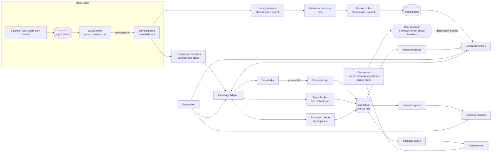
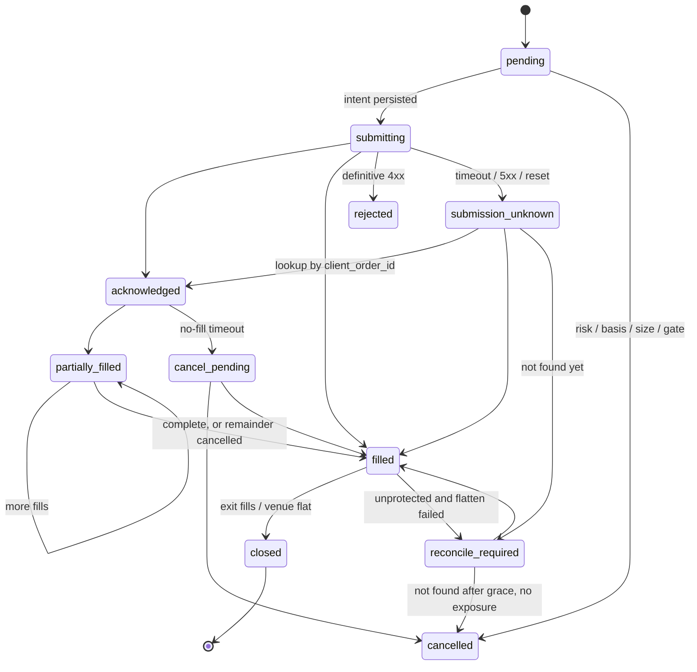

# Architecture

Signal Bot is one asyncio process built from independently testable components
that communicate through two kinds of channels:

* **Candle fan-out** (`storage/writer.py`): every closed candle is persisted, then
  delivered to each subscriber's own queue, filtered by interval.
* **Event bus** (`events/`): typed, identified events. Durable ones are written to the
  PostgreSQL journal *before* delivery, and each consumer has its own queue,
  checkpoint and startup replay.

The strategy config chooses the signal source. The default, the trend portfolio,
is shown; the 2.0 liquidity sweep (HTF scanner, microstructure engine, sweep
detector) still runs with `STRATEGY_CONFIG=.../liquidity_sweep.toml`.

## The event contract

`events/envelope.py` defines `Event`:

| Field | Meaning |
|---|---|
| `event_id` | Stable identity. Exchange facts use `deterministic_event_id(venue, kind, exchange ids…)`, so a fill redelivered by the socket, a REST poll or a replay maps to the same id. |
| `event_type` | `CANDLE_CLOSED`, `SIGNAL_GENERATED`, `EXCHANGE_ORDER_UPDATE`, `EXCHANGE_FILL`, `EXCHANGE_POSITION_UPDATE`, `ORDER_STATE_CHANGED`, `POSITION_CLOSED`, `PROTECTIVE_ORDER_FAILED`, `RISK_DENIED`, `RISK_HALT`, `RISK_RESUMED`, `STREAM_CONNECTED/DISCONNECTED`, `RECONCILIATION_*`, `OPERATOR_ACTION` |
| `source` | Producing component or venue |
| `occurred_at` / `recorded_at` | Source time and local time |
| `correlation_id` / `causation_id` | The signal id threads through every event and log line of a trade; causation links an event to the one that caused it |
| `schema_version` | Payload schema version |
| `sequence` | Global journal order, assigned on append |

Delivery is **at least once**: a consumer that crashes between processing and
`ack()` sees the event again on replay. Correctness therefore comes from
idempotent consumers:

* order transitions are keyed by `event_id` (unique) and follow sequence rules;
* fills are keyed by `fill_id` (primary key), so their financial effect lands once;
* a trade's outcome is keyed by `signal_id` and written in the same transaction as
  the risk-state update.

If the journal is unavailable, durable events are still delivered and are buffered
for a later write (`JOURNAL_PENDING` metric, `JournalUnavailable` alert). A database
outage therefore does not blind the engine or the position view.

## Order state machine

`execution/orders.py` holds the transition table; `execution/order_store.py` applies
transitions transactionally (`SELECT … FOR UPDATE` on PostgreSQL), records each one
in `order_transitions` and only then publishes `ORDER_STATE_CHANGED`. Rules:

* duplicate `event_id` → ignored;
* exchange timestamp older than the last applied → stale;
* `filled_size` lower than recorded → stale (a late partial after a fill is not a reversal);
* lifecycle regression (e.g. `acknowledged` after `filled`) → stale.

The legacy `signals.status` column is mirrored for Telegram and the daily summary.

## Execution safety properties

| Property | Where |
|---|---|
| No order without a healthy governor approval *and* an open synchronous gate right before the call | `ExecutionEngine._risk_check`, `RiskGovernor.gate_open` |
| Intent persisted before any network call | `submitting` transition precedes `place_order` |
| Ambiguous submission never resent; trading blocked until resolved | `resolve_unknown`, `unresolved_order:*` breaker, reconciler |
| One exposure per venue symbol (venues net per product) | `symbol_already_exposed` check |
| Protected or flat: stop confirmed on the venue after every fill; otherwise kill switch, then standalone stop, then flatten | `ensure_protection` |
| Stream loss blocks trading until reconnect *and* a reconciliation pass | `exchange_stream` breaker, `_recover_stream` |
| Stale books, stale signals and late candles never trade | `max_book_age_seconds`, `max_signal_age_seconds`, `candle_is_fresh` |
| Worst-case daily loss: realised R minus 1R per open trade and per new trade stays within the limit | `daily_loss_budget` rule |

## Trend portfolio (`signals/trend*.py`, `risk/portfolio.py`, `execution/trailing.py`)

At every 4h close, in one task, so the order is fixed:

1. The completed candle joins `CandleHistory`. A candle that is still forming, a
   duplicate or out of order is refused.
2. The trailing manager moves each open position's exchange stop to the research
   rule's level (never looser) and runs time stops.
3. `signals.trend.trend_decisions`, the same function the backtest uses, evaluates
   the newest bar.
4. Decisions wait until every tradable symbol has reported that bar (or a timeout).
   `risk.portfolio.admit` then ranks them and sizes them on shared, marked-to-market
   equity in whole contracts. It applies the position, open-risk, correlated-risk,
   leverage, entries-per-bar and drawdown limits.
5. Accepted signals carry their planned contracts, trail distance and time stop to
   the engine.
6. The governor re-runs the same rules on the current book just before submission.
   It fails closed.

Candles that arrive late update history but never trade. Every decision is persisted:
refusals are cancelled signals with a `portfolio:<rule>` reason and a `RISK_DENIED`
event.

## Risk governor

`risk/governor.py`:

* **Persisted kill switch**: set by an operator (control room or CLI), by the
  consecutive-loss limit, or by a protective-order failure. Only an explicit,
  audited operator action clears it.
* **Circuit breakers**: in-memory and condition-bound, cleared by the component that
  raised them once the condition recovers: `exchange_stream`, `exchange_auth`,
  `unresolved_order:<id>`, `orphan_position:<symbol>`, `task_crashed`, and
  `portfolio_drawdown` (trend mode: equity 20% below its peak).
* **Limits**: daily loss (realised and worst-case budget), trades per day (counted
  at submission), concurrent exposure (any order that may hold exposure), consecutive
  losses, minimum balance.
* **Fail closed**: risk-state read errors, balance errors or a stalled monitor make
  `healthy` false, and the engine refuses to submit.

## Venues

* `execution/delta_adapter.py`: Delta India REST and socket mapping, error
  taxonomy (rejected, ambiguous, auth, unavailable), 10 s request timeouts, lookup
  by client order id. Field mappings marked `VERIFY` must be confirmed on testnet
  before live use.
* `venues/simulated.py`: deterministic matching engine with a fault plan. Stops
  can be amended (stepped trailing) or trail natively from the mid price.
* `venues/paper.py`: the simulator driven by live Delta order books, with latency,
  fees, funding, a persisted ledger and restart-safe state.

## Observability

* JSON logs with `correlation_id`, `signal_id`, `order_id` and `event_id` from context
  variables (`observability/logging.py`).
* Prometheus metrics (`observability/metrics.py`): market-data age, queue lag,
  exchange latency, rejected orders, unknown submissions, risk denials, breaker count,
  reconciliation discrepancies, processing failures, journal health and paper equity.
* `deploy/`: Prometheus scrape config and alert rules, plus a provisioned Grafana
  dashboard (`docker compose up`).
* Control room at `/` and `/api/status`; `/readyz` returns 503 with reasons whenever
  the bot cannot trade.
